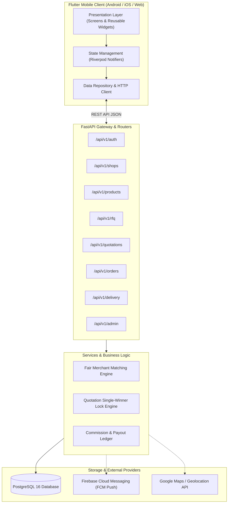
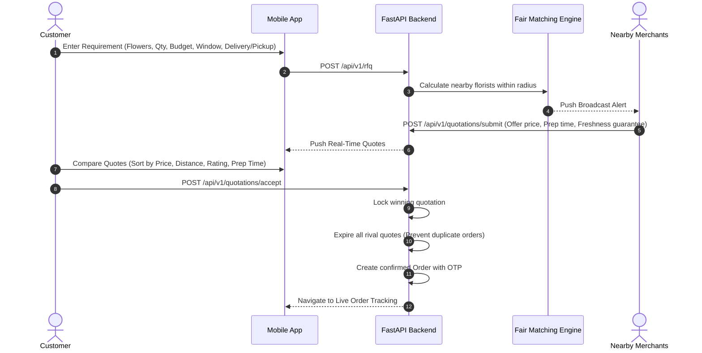

# FlowerConnect Architecture Specification

## 1. System Overview

**FlowerConnect** is an on-demand hyperlocal marketplace designed to connect consumers with neighborhood flower vendors, small roadside flower stalls, boutique florist studios, and gift shops.

The platform combines two distinct fulfillment paradigms:
1. **Instant Catalogue Ordering**: Browsing nearby shops, choosing flowers or gifts, and placing direct pickup or delivery orders.
2. **Dynamic Price Quotation System (RFQ)**: A customer broadcasts a custom flower requirement or event order. The system matches nearby merchants within a 5 km radius, who submit competing price quotations. The customer compares quotes and accepts one, automatically locking the winning quote and expiring competing quotes.

---

## 2. Technology Stack

- **Mobile Application**: Flutter 3.47+ (Dart 3.13+)
- **State Management**: Riverpod 3 (NotifierProvider & StateNotifier)
- **Backend Architecture**: Clean Architecture (Domain, Data, Presentation layers)
- **Backend Framework**: Python 3.11+ / FastAPI
- **Relational Database**: PostgreSQL 16 with async SQLAlchemy 2.0 ORM & Alembic migrations
- **Authentication**: JWT Bearer Tokens with Firebase Auth bridge support
- **Fair Matching Engine**: Haversine Geolocation Matrix with anti-monopoly fair distribution weighting
- **Containerization**: Docker & Docker Compose

---

## 3. High-Level Architecture Diagram

---

## 4. Dynamic Price Quotation Workflow

---

## 5. Security & Privacy Guarantees

1. **Information Masking**:
   - Customer phone numbers and exact delivery addresses are **hidden** from bidding merchants during the RFQ phase.
   - Only approximate customer distance (e.g., "1.2 km away in Indiranagar") is revealed until the customer accepts a quotation.
2. **Single-Winner Atomic Lock**:
   - Competing bids are locked to `REJECTED` or `EXPIRED` immediately upon customer acceptance, eliminating merchant double-fulfillment.
3. **Escrow Delivery Verification**:
   - Delivery partner and merchant payouts are held in escrow until the customer's 4-digit OTP is verified at delivery handover.

